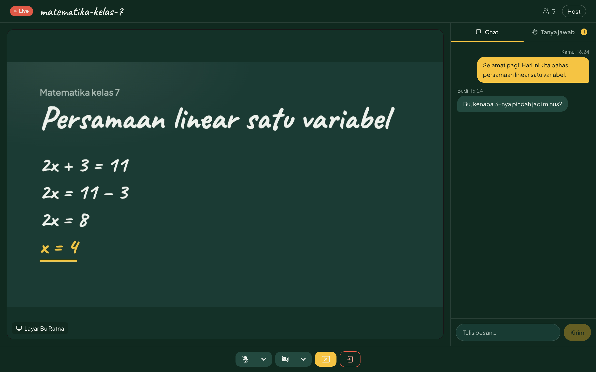
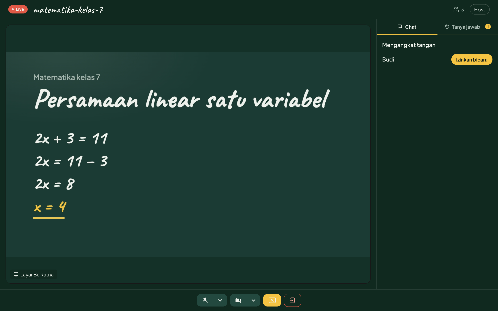
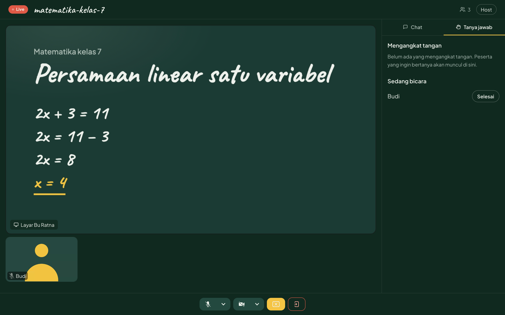
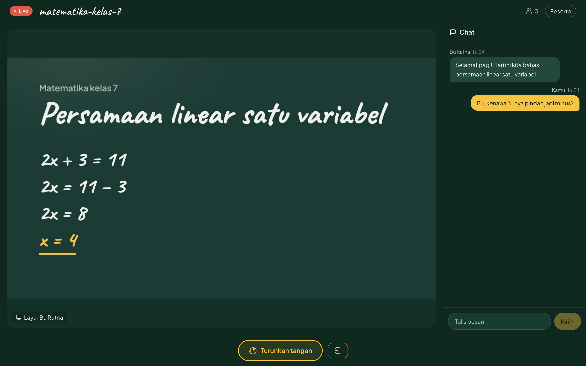
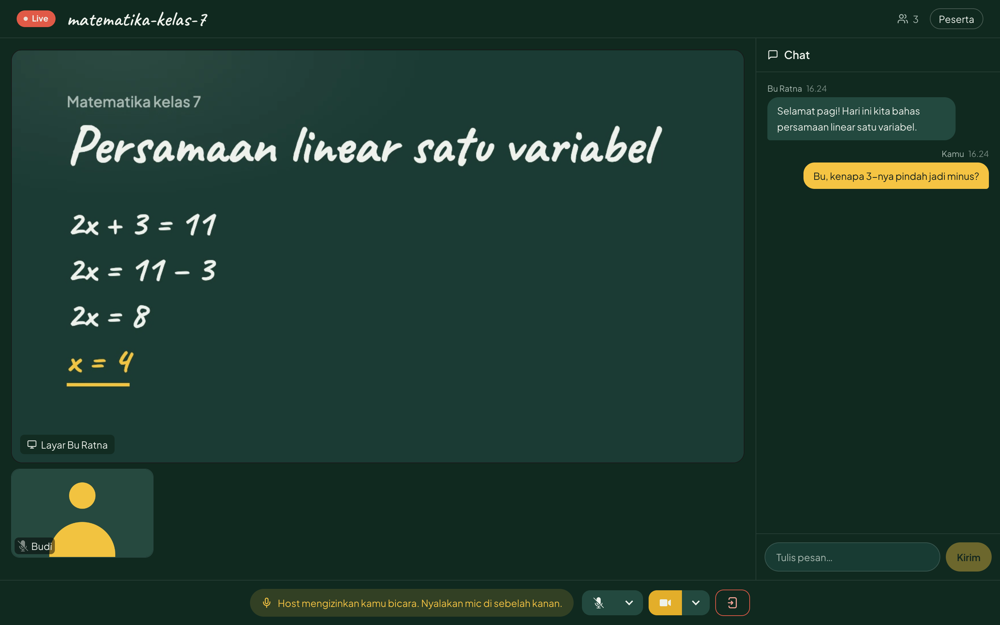
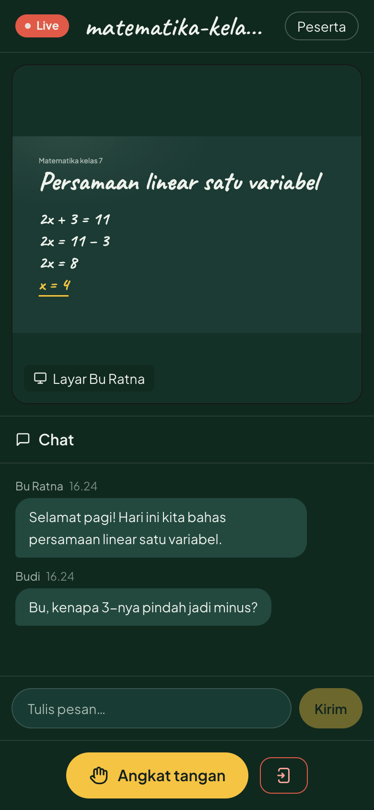
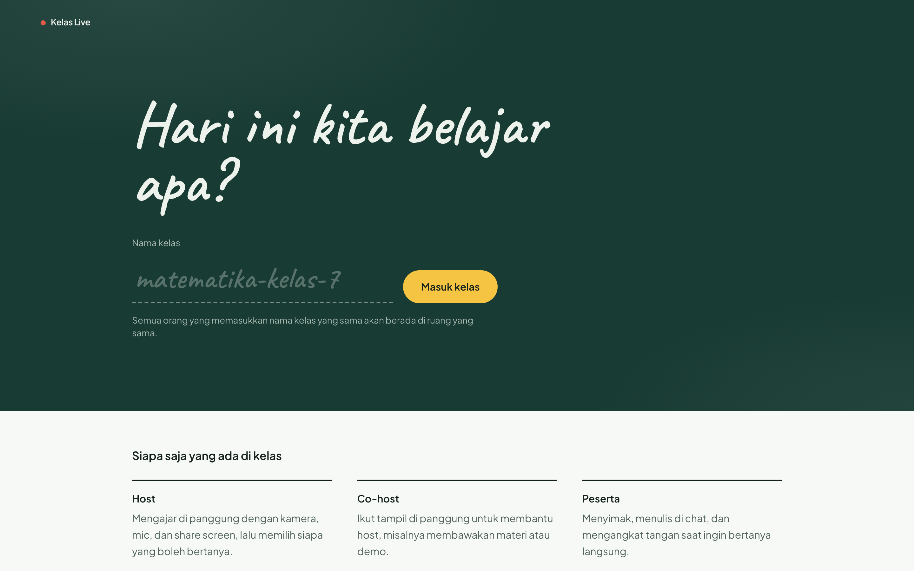
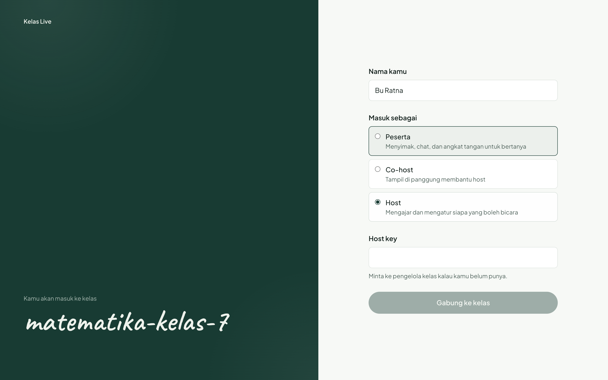

# Spring Boot Live Streaming

[](https://github.com/hendisantika/spring-boot-live-streaming/actions/workflows/ci.yml)
[](https://live.jvm.my.id)

🔴 **Live demo: [https://live.jvm.my.id](https://live.jvm.my.id)**: masukkan nama kelas, lalu gabung sebagai Peserta.
Buka kelas yang sama di dua perangkat untuk mencoba chat dan angkat tangan.

Platform **kelas live** yang bisa ditanam di web maupun aplikasi mobile: host dan co-host tampil di
panggung (kamera, mic, share screen), peserta menyimak, chat, dan sesekali tanya jawab.
Dirancang untuk kelas dengan peserta rata-rata di bawah 100 orang.

Media real-time ditangani [LiveKit](https://livekit.io) (WebRTC SFU). Repo ini berisi:

- **Backend Spring Boot** (root): token server dan pengatur peran peserta.
- **Frontend Next.js** ([`frontend/`](frontend)): halaman kelas untuk web.

## Screenshot

Diambil dari https://live.jvm.my.id dengan [`frontend/scripts/screenshots.mjs`](frontend/scripts/screenshots.mjs).

### Host

| Mengajar dengan share screen | Peserta mengangkat tangan | Mengizinkan peserta bicara |
|---|---|---|
|  |  |  |

### Peserta

| Menyimak dan angkat tangan | Diizinkan bicara oleh host | Di ponsel |
|---|---|---|
|  |  |  |

### Halaman depan dan form gabung

| Halaman depan | Form gabung |
|---|---|
|  |  |

## Arsitektur

```
Next.js (web)  ─┐                            ┌─> LiveKit Server (SFU)
Mobile app     ─┼─> Spring Boot (repo ini) ──┤     media: kamera, mic, share screen
                │   - token per peran        │     data : chat, angkat tangan
                │   - promote/demote penanya │
                └──────── connect pakai token ─────────> LiveKit
```

API secret LiveKit hanya disimpan di backend. Client (web atau mobile) cukup meminta token ke
backend lalu terhubung langsung ke LiveKit.

## Fitur

| Peran | Kemampuan |
|---|---|
| **Host** | Kamera, mic, share screen, chat. Melihat daftar angkat tangan, mengizinkan peserta bicara dan menurunkannya lagi. |
| **Co-host** | Kamera, mic, share screen, chat. |
| **Peserta** | Menonton, chat, angkat tangan. Setelah diizinkan host: mic dan kamera (tanpa share screen). |

## Tech Stack

- Java 25, Spring Boot 4.1, LiveKit Server SDK (`io.livekit:livekit-server`), springdoc-openapi (Swagger UI)
- Next.js 16, React 19, Tailwind CSS 4, LiveKit React Components
- LiveKit Server (self-host atau LiveKit Cloud)

## Menjalankan Secara Lokal

Prasyarat: JDK 25, Maven, Node.js 22/24, [Bun](https://bun.sh), dan LiveKit Server.

1. **LiveKit Server** (mode dev, key `devkey` / secret `secret`):
   ```bash
   livekit-server --dev
   # atau dengan Docker:
   docker run --rm -p 7880:7880 -p 7881:7881 -p 7882:7882/udp \
     livekit/livekit-server --dev --bind 0.0.0.0 --node-ip 127.0.0.1
   ```

2. **Backend** (port 8080):
   ```bash
   LIVEKIT_HOST_ACCESS_KEY=rahasia-host mvn spring-boot:run
   ```

3. **Frontend** (port 3000):
   ```bash
   cd frontend
   cp .env.example .env.local
   bun install
   bun run dev
   ```

4. Buka http://localhost:3000, masukkan nama kelas, lalu gabung sebagai **Host** (isi host key) di satu tab
   dan sebagai **Peserta** di tab lain.

## Konfigurasi Backend

Semua diatur lewat environment variable (lihat [`application.properties`](src/main/resources/application.properties)).

| Variabel | Default | Keterangan |
|---|---|---|
| `LIVEKIT_URL` | `ws://localhost:7880` | URL WebSocket LiveKit yang dikirim ke client |
| `LIVEKIT_API_URL` | `http://localhost:7880` | URL HTTP LiveKit untuk server API |
| `LIVEKIT_API_KEY` | `devkey` | API key LiveKit |
| `LIVEKIT_API_SECRET` | `secret` | API secret LiveKit |
| `LIVEKIT_HOST_ACCESS_KEY` | _(kosong)_ | Kunci untuk meminta token Host / Co-host. Kalau kosong, token Host / Co-host tidak bisa diminta. |
| `LIVEKIT_ALLOWED_ORIGINS` | `http://localhost:3000` | Origin frontend yang diizinkan (CORS), pisahkan dengan koma |

> ⚠️ Default `devkey` / `secret` hanya untuk mode dev LiveKit. Di produksi wajib diganti.

## API

📖 **Dokumentasi interaktif (Swagger UI): [https://streaming.jvm.my.id/api/docs](https://streaming.jvm.my.id/api/docs)**.
Spec OpenAPI: [`/api/openapi`](https://streaming.jvm.my.id/api/openapi). Saat lokal: http://localhost:8080/api/docs.
Untuk mencoba promote/demote, klik **Authorize** lalu isi `hostToken` dengan token milik HOST.

| Method | Endpoint | Keterangan |
|---|---|---|
| `POST` | `/api/rooms/{room}/token` | Body `{"identity", "name", "role"}`; `role` = `HOST` / `CO_HOST` / `VIEWER` (default). Host / Co-host wajib header `X-Host-Key`. |
| `POST` | `/api/rooms/{room}/participants/{identity}/promote` | Izinkan peserta bicara (mic & kamera). Header `Authorization: Bearer <token host>`. |
| `POST` | `/api/rooms/{room}/participants/{identity}/demote` | Kembalikan jadi peserta biasa. Header `Authorization: Bearer <token host>`. |

Contoh:

```bash
curl -X POST http://localhost:8080/api/rooms/kelas-1/token \
  -H 'Content-Type: application/json' \
  -d '{"identity":"siswa-1","name":"Budi"}'
```

Error dikembalikan dalam format [Problem Details (RFC 9457)](https://www.rfc-editor.org/rfc/rfc9457).

## Integrasi Mobile

Aplikasi mobile memakai endpoint token yang sama, lalu terhubung dengan SDK LiveKit native:
[React Native](https://github.com/livekit/client-sdk-react-native),
[Flutter](https://github.com/livekit/client-sdk-flutter),
[Swift](https://github.com/livekit/client-sdk-swift), atau
[Android](https://github.com/livekit/client-sdk-android).
Angkat tangan dikirim lewat data channel dengan topic `raise-hand` dan payload `{"raised": true|false}`.

## Deployment (Produksi)

| Komponen | Domain | Hosting |
|---|---|---|
| Frontend Next.js | [https://live.jvm.my.id](https://live.jvm.my.id) | Vercel (root directory `frontend`, auto deploy dari `main`) |
| Backend Spring Boot | `https://streaming.jvm.my.id/api` | Docker di server, di belakang nginx |
| LiveKit signaling | `wss://streaming.jvm.my.id/rtc` | Docker di server yang sama, di belakang nginx |
| Dokumentasi API | [https://streaming.jvm.my.id/api/docs](https://streaming.jvm.my.id/api/docs) | Swagger UI (springdoc-openapi) |
| Health check nginx | [https://streaming.jvm.my.id/healthz](https://streaming.jvm.my.id/healthz) | Mengembalikan `ok` |

> `https://streaming.jvm.my.id/` dan `GET /api/` memang mengembalikan 404: backend hanya melayani endpoint
> di bagian [API](#api) (mis. `POST /api/rooms/{room}/token`).

### Frontend (Vercel)

- Env Vercel: `NEXT_PUBLIC_API_URL=https://streaming.jvm.my.id`
- DNS (Cloudflare): `CNAME live → <target dari "vercel domains verify live.jvm.my.id">`, mode **DNS only** (awan abu-abu).

### Backend + LiveKit (Docker di server)

Image backend: [`hendisantika/live-streaming-service`](https://hub.docker.com/r/hendisantika/live-streaming-service),
dengan tag = nomor run GitHub Actions (plus `latest`).

Workflow [`ci.yml`](.github/workflows/ci.yml) (job `docker` dan `deploy`) berjalan setiap push ke `main`, setelah test backend lulus:

1. Build image dari [`Dockerfile`](Dockerfile), lalu push ke Docker Hub dengan tag `<run_number>` dan `latest`.
2. Masuk ke server lewat SSH (dengan retry, karena port SSH server ramai bot) dan menjalankan [`deploy/remote-deploy.sh`](deploy/remote-deploy.sh): mengambil
   [`deploy/compose.yaml`](deploy/compose.yaml) dan [`deploy/livekit.yaml`](deploy/livekit.yaml) dari commit
   yang sama ke `~/live-streaming`.
3. Menjalankan `docker compose pull && docker compose up -d`, lalu health check ke API.

Di server berjalan dua container:

| Container | Port | Keterangan |
|---|---|---|
| `live-streaming-service` | `127.0.0.1:8020` | Backend Spring Boot (diakses lewat nginx `/api`) |
| `live-streaming-livekit` | `127.0.0.1:7880`, `7881/tcp`, `7882/udp` | LiveKit: signaling lewat nginx `/rtc`, media WebRTC langsung |

**Secret & variable GitHub** (Settings → Secrets and variables → Actions):

| Nama | Jenis | Isi |
|---|---|---|
| `DOCKERHUB_USERNAME` | secret | Username Docker Hub |
| `DOCKERHUB_TOKEN` | secret | Access token Docker Hub (Read & Write) |
| `SSH_PRIVATE_KEY` | secret | Private key deploy (khusus CI) |
| `LIVEKIT_API_KEY` | secret | API key LiveKit (dipakai backend dan LiveKit Server) |
| `LIVEKIT_API_SECRET` | secret | API secret LiveKit, minimal 32 karakter |
| `LIVEKIT_HOST_ACCESS_KEY` | secret | Kunci untuk masuk sebagai Host / Co-host |
| `SSH_HOST`, `SSH_PORT`, `SSH_USER` | variable | Alamat server SSH. Job deploy hanya jalan kalau `SSH_HOST` terisi. |

**Tidak ada file `.env` di server.** Secret LiveKit dikirim dari GitHub Secrets lewat stdin SSH
(tidak muncul di argumen proses), lalu diteruskan ke container sebagai environment saat `docker compose up`.
Nilai non-rahasia (`LIVEKIT_URL`, `LIVEKIT_ALLOWED_ORIGINS`, `LIVEKIT_NODE_IP`) punya default di
[`deploy/compose.yaml`](deploy/compose.yaml).

**Persiapan server (sekali saja):**

1. Pasang config nginx [`nginx/streaming.jvm.my.id.conf`](nginx/streaming.jvm.my.id.conf) (langkah ada di header file).
   TLS diterminasi Cloudflare, jadi nginx cukup `listen 80`.
2. Buka firewall untuk media WebRTC: `7881/tcp` dan `7882/udp`.
3. DNS Cloudflare: `streaming` → IP server (proxied). Signaling WebSocket bisa lewat Cloudflare,
   sedangkan media WebRTC langsung ke IP server (`LIVEKIT_NODE_IP`).

## Testing

```bash
mvn verify                                  # backend
cd frontend && bun run lint && bun run build  # frontend
```

## CI & Dependabot

- [GitHub Actions](.github/workflows/ci.yml) (satu workflow CI/CD): build dan test backend serta frontend pada setiap
  push / PR ke `main` dan setiap hari pukul 05.00 WIB. Push ke `main` juga mem-build image Docker backend
  dan men-deploy-nya ke server.
- [Dependabot](.github/dependabot.yml): cek update Maven, bun (frontend), dan GitHub Actions setiap hari pukul 05.00 WIB.

## Keterbatasan Saat Ini

- Host key adalah pengaman sementara. Untuk produksi perlu login / autentikasi sungguhan.
- Daftar angkat tangan disimpan di browser host, jadi akan kosong lagi kalau host me-refresh halaman.
- Belum ada rekaman kelas (bisa ditambahkan dengan LiveKit Egress).

## Author

**Hendi Santika**
- Email: hendisantika@gmail.com
- Telegram: [@hendisantika34](https://t.me/hendisantika34)
- Link: [s.id/hendisantika](https://s.id/hendisantika)
